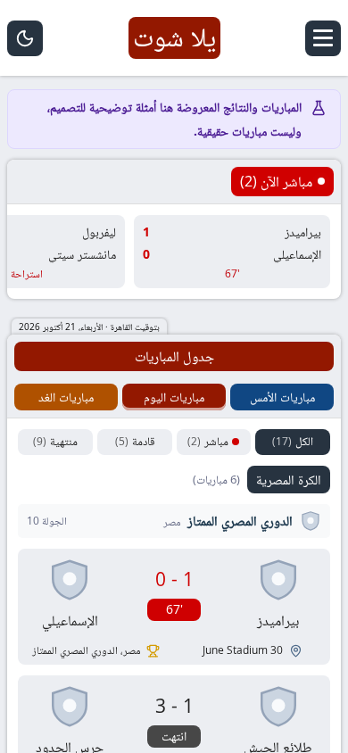
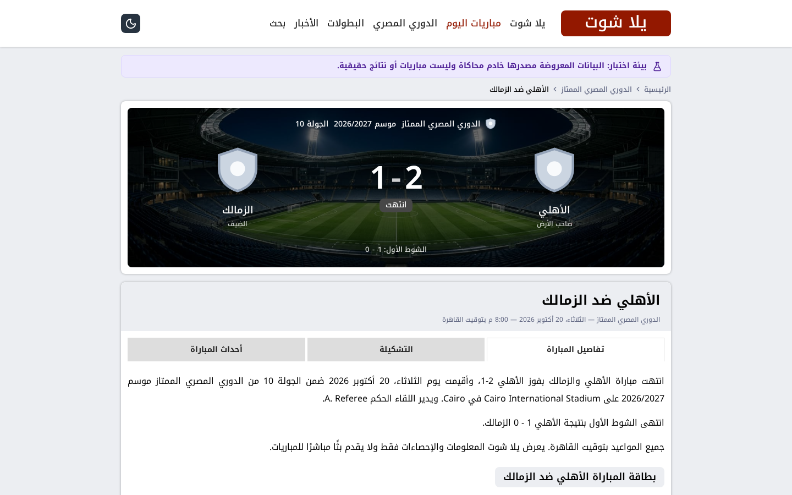
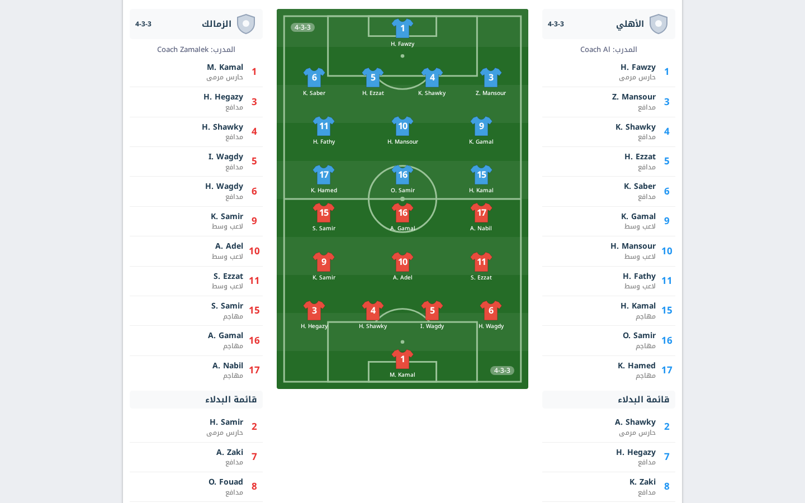
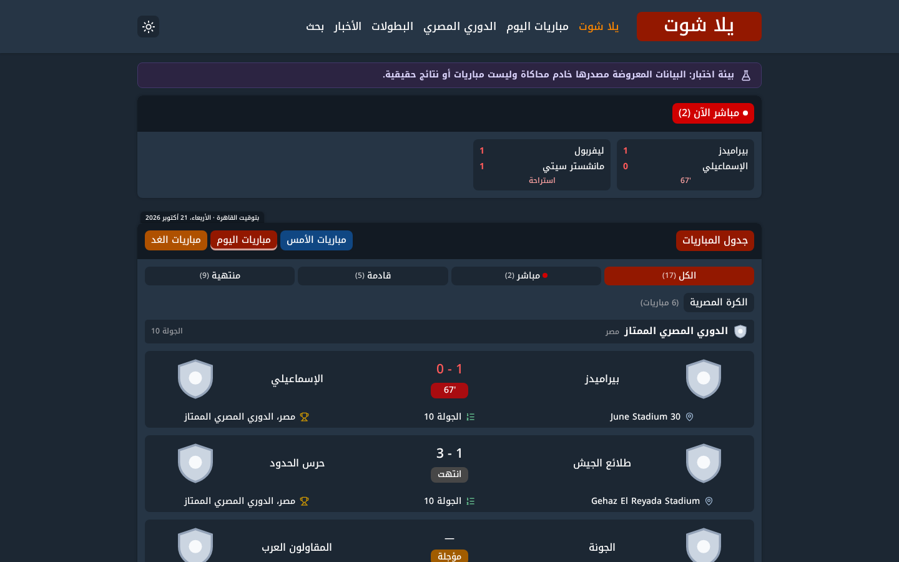

# يلا شوت | Yalla Shoot

موقع عربي (RTL) لمواعيد ونتائج مباريات كرة القدم **بتوقيت القاهرة** مع أولوية للكرة المصرية، مبني بـ
Next.js (App Router) و TypeScript (strict) و Tailwind CSS، وجاهز للنشر على Vercel.

- **التصميم:** يطابق تصميم موقع `yalla.cheap` (الهيدر الأبيض بشعار «يلا شوت» النصي على المربع العنابي، الخلفية
  الرمادية، البلوكات البيضاء ذات الرأس الرمادي وعنوان «الحبة»، أزرار مباريات الأمس/اليوم/الغد الملونة، بطاقات
  المباريات، صفحة المباراة بخلفية الملعب والتبويبات والتشكيلة على أرض الملعب وخط الأحداث، الوضع الليلي، القائمة
  الجانبية على الجوال). مكتوب من الصفر دون نسخ كود القالب أو صوره أو خطوطه — التفاصيل في [docs/design.md](docs/design.md).
- **البيانات حقيقية فقط** من مزود بيانات رياضي (API-Football) عبر طبقة بيانات موحدة، ولا توجد أي بيانات وهمية تُعرض
  كمباريات حقيقية. خادم البيانات النموذجية يُستخدم في الاختبارات ومراجعة التصميم فقط، ومعروض معه سطر يوضّح أن
  المباريات أمثلة، ويختفي تلقائيًا بمجرد ضبط المزود الرسمي.
- **لا بث مباشر ولا روابط مشاهدة**، ولا تُعرض قنوات أو معلقون إلا إذا أضافها فريق التحرير من مصدر موثق.

| الرئيسية (جوال) | صفحة المباراة | التشكيلة | الوضع الليلي |
| --- | --- | --- | --- |
|  |  |  |  |

> الصور ملتقطة من الاختبارات الآلية على **بيانات نموذجية** (لذلك تظهر شعارات بديلة رمادية وسطر «أمثلة توضيحية»).

---

## 1. المتطلبات

- **Node.js 22.12 أو أحدث** (الملف `.nvmrc` = 22) و npm 10.
- حساب API-Football (مجاني للتجربة، مدفوع للإنتاج — انظر القسم 4).
- اختياري لكنه موصى به بشدة في الإنتاج: قاعدة **Upstash Redis** (تُضاف من Vercel Marketplace).

## 2. التشغيل محليًا

```bash
npm ci                       # تثبيت من ملف القفل
cp .env.example .env.local   # ثم ضع FOOTBALL_API_KEY
npm run dev                  # http://localhost:3000
```

بدون مفتاح API يعمل الموقع ويعرض رسالة واضحة «مصدر البيانات غير مربوط بعد» بدل أي بيانات مختلقة.

للتجربة على بيانات المحاكاة (بدون مفتاح حقيقي):

```bash
npm run mock:api   # خادم محاكاة على المنفذ 4010
FOOTBALL_API_BASE_URL=http://127.0.0.1:4010 FOOTBALL_API_KEY=test-key npm run dev
```

أوامر مفيدة: `npm run typecheck` · `npm run lint` · `npm test` · `npm run build` · `npm run test:e2e` ·
`npm run check:provider` · `npm run admin:hash -- "كلمة-مرور-طويلة"`.

## 3. متغيرات البيئة

| المتغير | إلزامي؟ | الوصف |
| --- | --- | --- |
| `FOOTBALL_API_KEY` | نعم للبيانات | مفتاح API-Sports (يُستخدم على الخادم فقط، لا يصل للمتصفح). |
| `FOOTBALL_API_BASE_URL` | لا | الافتراضي `https://v3.football.api-sports.io`. غيّره للاختبار فقط. |
| `FOOTBALL_API_PROVIDER` | لا | `api-football` (المزود المدعوم حاليًا). |
| `FOOTBALL_API_TIMEOUT_MS` | لا | مهلة الطلب (افتراضي 8000). |
| `FOOTBALL_API_DAILY_LIMIT` / `FOOTBALL_API_MINUTE_LIMIT` | لا | تُكتشف تلقائيًا من ترويسات المزود. |
| `FOOTBALL_API_RESERVE_PERCENT` | لا | نسبة من الحصة اليومية محجوزة لطلبات اليوم/المباشر (افتراضي 10). |
| `FOOTBALL_TTL_SCALE` | لا | مضاعف مدد التخزين؛ فارغ = تلقائي حسب الباقة. |
| `NEXT_PUBLIC_SITE_URL` | موصى به | الرابط الأساسي للموقع بدون `/` في النهاية (canonical، sitemap، OG). |
| `UPSTASH_REDIS_REST_URL` / `UPSTASH_REDIS_REST_TOKEN` | موصى به في الإنتاج | تخزين مشترك (أو `KV_REST_API_URL` / `KV_REST_API_TOKEN` من Vercel). |
| `ADMIN_USERNAME` / `ADMIN_PASSWORD_HASH` / `ADMIN_SESSION_SECRET` | لتفعيل الإدارة | لا توجد كلمة مرور افتراضية؛ اللوحة معطلة حتى تُضبط الثلاثة. |
| `EDITOR_USERNAME` / `EDITOR_PASSWORD_HASH` | لا | حساب محرر محدود (أخبار ومعلومات بث). |
| `CRON_SECRET` | للكرون | Vercel يرسله تلقائيًا في ترويسة Authorization. |
| `SITE_CONTACT_EMAIL` | لا | بريد التواصل في صفحة «اتصل بنا». |
| `NEWS_FEED_ALLOWED_HOSTS` | لا | قائمة نطاقات مسموحة لخلاصات الأخبار المرخصة. |
| `FRAME_ANCESTORS` / `EXTRA_IMAGE_HOSTS` | لا | إعدادات CSP (تُقرأ وقت البناء). |

لا تضع أي قيمة حقيقية في `.env.example` أو في Git.

## 4. مزود البيانات ولماذا API-Football

| المزود | الكرة المصرية | الباقة المجانية |
| --- | --- | --- |
| **API-Football (API-Sports v3)** ✅ | الدوري المصري، كأس مصر، كأس الرابطة، الدرجة الثانية، السوبر، أبطال إفريقيا والكونفدرالية | 100 طلب/يوم، 10 طلبات/دقيقة |
| Sportmonks | تتطلب باقة مدفوعة | الدنمارك واسكتلندا فقط |
| football-data.org | غير متاحة | 12 بطولة أوروبية/عالمية |

**قيود الباقة المجانية في API-Football (مهم):** 100 طلب يوميًا (تتجدد 00:00 UTC) و10 في الدقيقة، والتاريخ في
`fixtures?date=` محصور بين الأمس والغد، والمواسم المتاحة محدودة (صفحة الأسعار في أكتوبر 2026: «محدودة في المواسم
المتاحة»، ورسائل المزود وقت البناء ذكرت 2021–2024)؛ لذلك **صفحات البطولات/الفرق/اللاعبين للموسم الحالي تحتاج غالبًا
باقة مدفوعة** (Pro ‏$19 شهريًا = 7,500 طلب/يوم، Ultra ‏$29 = 75,000، Mega ‏$39 = 150,000). عند منع
الباقة لطلب ما يعرض الموقع رسالة واضحة ولا يخترع بيانات.

**اختبار الاتصال:** `FOOTBALL_API_KEY=... npm run check:provider` يطبع حالة الحساب والحصة والتغطية المصرية الفعلية،
ويقارن فرق توقيت القاهرة الذي يكتبه المزود في كل مباراة بحساب الموقع (يشمل التوقيت الصيفي)، ويعرض مباريات مصر اليوم
بتوقيت القاهرة لتقارنها بالجدول الرسمي. ويمكن التحقق من التغطية أيضًا من لوحة الإدارة ← «البطولات والتغطية» ← «تشغيل
التحقق الآن». معرّفات البطولات المصرية والإفريقية وأدلة تأكيدها في `docs/data-coverage.md`.

**حل مشكلة «تعذّر التحقق من حساب مزود البيانات»:** هذه الرسالة تعني أن المزود ردّ برفض المفتاح (HTTP 401/403 أو
خطأ `token`)، أي أن `FOOTBALL_API_KEY` مضبوط لكنه غير مقبول. للتشخيص: لوحة الإدارة (`/admin`) تعرض تنبيهًا إذا كان
شكل المفتاح نفسه غير مطابق لمفاتيح API-Sports (64 حرفًا ست عشريًا)، وتعرض «آخر خطأ» بنصّه الحرفي من المزود، وصفحة
«السجلات» تعرض كل طلب فاشل بسببه. أشهر الأسباب بالترتيب: (1) المفتاح من RapidAPI وليس من
`dashboard.api-football.com` — مفاتيح RapidAPI لا تعمل هنا؛ (2) مسافات زائدة أو نسخ ناقص؛ (3) لصق السطر كاملًا
`FOOTBALL_API_KEY=...` في خانة القيمة؛ (4) الحساب جديد ولم يفعَّل بالإيميل بعد؛ (5) تعديل المتغير في Vercel بدون
**Redeploy** (التعديلات لا تسري على النشر القائم). اختبار سريع من جهازك:
`curl -s -H "x-apisports-key: YOUR_KEY" "https://v3.football.api-sports.io/status"` — لو رجّع `errors.token`
فالمشكلة في المفتاح نفسه.

**شروط الاستخدام:** يسمح المزود باستخدام البيانات في المواقع والتطبيقات ويمنع إعادة بيعها، ولا يمنح ترخيص نشر نيابة
عن الاتحادات والروابط — مسؤولية الحصول على حقوق النشر التجاري تقع على مالك الموقع. لا تستخدم حسابات متعددة لزيادة الحد.

**تبديل المزود:** كل المزودين يطبقون الواجهة `FootballProvider` في `lib/football/providers/types.ts`؛ أضف مجلدًا جديدًا
بجانب `api-football/` يحوّل استجابات المزود إلى الأنواع الموحدة في `lib/football/types.ts`، ثم سجله في
`lib/football/providers/index.ts`. باقي الموقع لا يتغير.

دوال طبقة البيانات (`lib/football/service.ts`): `getLeagues` · `getLeagueDetails` · `getFixturesByDate` ·
`getLiveMatches` · `getMatchDetails` · `getHeadToHead` · `getStandings` · `getLeagueFixtures` · `getTopScorers` ·
`getTeams` · `getTeamDetails` · `getTeamCompetitions` · `getTeamFixtures` · `getPlayers` · `getPlayerDetails` ·
`searchFootball` (`lib/football/search.ts`).

## 5. التخزين المؤقت والتحديث (لماذا لا يستهلك الزوار حصة المزود)

- لا يطلب أي زائر من المزود مباشرة: الصفحات تُخدم من ذاكرة Next.js (ISR / `use cache`) ومن تخزين الخادم.
- كل مورد له مدة صلاحية حسب نوعه، مع دمج الطلبات المتزامنة (single-flight) وقفل مشترك عبر Redis.
- عند فشل المزود (شبكة/مهلة/5xx/429) تُعرض **آخر نسخة صحيحة** مع تنبيه «تعذّر التحديث» ووقت آخر تحديث، ولا تُستبدل
  بيانات جيدة بقائمة فارغة بسبب خطأ عابر، ولا تتراجع مباراة منتهية إلى حالة أقدم.
- حماية الحصة: إيقاف 60 ثانية بعد 429، إيقاف حتى منتصف الليل UTC عند نفاد الحصة اليومية، قاطع دائرة بعد 5 أخطاء
  خلال دقيقتين، وتطويل المدد ×10 تلقائيًا في الباقة المجانية.
- أثناء المباريات المباشرة يعيد المتصفح طلب الصفحة المخزنة فقط عندما تكون التبويبة ظاهرة وبحد أقصى للزيارة.

| البيانات | مدة الصلاحية (قبل مضاعف الباقة) |
| --- | --- |
| مباريات اليوم أثناء اللعب / قبل الانطلاق بقليل | دقيقتان |
| مباريات اليوم (لا مباريات جارية) | 10–30 دقيقة |
| الأمس / الغد | 15 دقيقة – 3 ساعات |
| تواريخ قديمة | يوم كامل |
| تفاصيل مباراة منتهية | 15 دقيقة بعد النهاية ثم 7 أيام |
| جداول الترتيب | 30 دقيقة (الموسم الحالي) / 7 أيام (مواسم سابقة) |
| البطولات والفرق والتشكيلات | 12 ساعة – 7 أيام |

**Cron:** `vercel.json` يستدعي `/api/cron/refresh` مرة يوميًا (03:00 UTC) — وهو الحد المسموح في باقة Vercel Hobby —
لتسخين الذاكرة (مباريات اليوم، الترتيب، قائمة البطولات). التحديث أثناء اليوم يتم عند الطلب وفق المدد أعلاه.

**Upstash Redis:** من لوحة Vercel ← Storage ← Marketplace ← Upstash (Redis) ← اربطه بالمشروع؛ يضيف المتغيرات تلقائيًا.
بدونه يعمل الموقع بذاكرة مؤقتة داخل كل نسخة خادم فقط (لا يُنصح به للإنتاج).

## 6. لوحة الإدارة (`/admin`)

1. `npm run admin:hash -- "كلمة-مرور-طويلة-وفريدة"` ← انسخ الناتج إلى `ADMIN_PASSWORD_HASH`.
2. اضبط `ADMIN_USERNAME` و `ADMIN_SESSION_SECRET` (‏32 حرفًا عشوائيًا فأكثر، مثل `openssl rand -base64 48`).
3. أعد النشر ثم افتح `/admin/login`.

تعرض: حالة المزود والحصة وآخر طلب ناجح والأخطاء، حالة الكرون، سجل الطلبات، التحقق من تغطية البطولات، إعادة جلب
البيانات يدويًا، إعدادات العرض (إخفاء/إبراز بطولات، تنبيه عام، وتيرة التحديث المباشر)، المقالات التحريرية، مصادر
الأخبار (تفعيل/تعطيل وإضافة)، ومعلومات البث الموثقة. **لا يمكن من اللوحة تعديل نتيجة أو موعد أو أي بيانات من المزود.**
الحماية: كلمات مرور scrypt، جلسة موقعة HttpOnly لمدة 8 ساعات، حد لمحاولات الدخول، `noindex`، CSRF عبر Server Actions.

## 7. النشر على GitHub و Vercel

1. ادفع المستودع إلى GitHub (الفرع الحالي أو `main`).
2. في Vercel: **Add New → Project** ← اختر المستودع. الإعدادات تُقرأ من `vercel.json`:
   Framework = Next.js، ‏Install = `npm ci`، ‏Build = `npm run build`، المنطقة `fra1` (الأقرب لمصر).
3. أضف متغيرات البيئة (القسم 3) لبيئة Production: على الأقل `FOOTBALL_API_KEY` و `NEXT_PUBLIC_SITE_URL`، ويفضل
   Upstash و `CRON_SECRET` وبيانات الإدارة.
4. اضغط Deploy، ثم افتح `/api/health` للتأكد من حالة المزود، و `/admin` لمتابعة الحصة.
5. اربط النطاق من Settings → Domains وحدّث `NEXT_PUBLIC_SITE_URL` ثم أعد النشر.

> باقة Vercel Hobby للاستخدام غير التجاري فقط؛ لموقع تجاري (إعلانات مثلًا) تلزم باقة Pro.

## 8. الاختبارات

| الأمر | ما يغطيه |
| --- | --- |
| `npm run typecheck` | TypeScript strict |
| `npm run lint` | ESLint (قواعد Next.js و React Hooks) |
| `npm test` | Vitest: التواريخ وتوقيت القاهرة، تحويل حالات المباريات، الدمج ومنع التراجع وإزالة التكرار، الحصة والتخزين، عميل المزود (429/5xx/مهلة)، البحث العربي، الأمان والإدارة، وعناصر الواجهة (بطاقة المباراة، الرأس، التبويبات، رسم التشكيلة) |
| `npm run test:e2e` | Playwright على 390px و1440px: الرئيسية، الأمس/اليوم/الغد، صفحة التاريخ، الدوري المصري، المباراة (تبويبات/تشكيلة/أحداث)، الفريق واللاعب، البحث عن الأندية المصرية، الحالات الفارغة وفشل المزود و429، الروابط الداخلية، 404، SEO والـ sitemap، الإدارة والكرون، الوضع الليلي والقائمة الجانبية، عدم وجود تمرير أفقي أو أخطاء Console |

اختبارات E2E تبني الموقع وتشغله مع خادم المحاكاة تلقائيًا (`scripts/e2e-server.mjs`، منفذ 3100). في بيئة بدون متصفح
Playwright استخدم `CHROMIUM_EXECUTABLE_PATH=/path/to/chrome`. تخزين الاختبار في `.data/e2e` (متجاهل في Git).

## 9. هيكل المشروع

```
app/                 الصفحات (App Router): الرئيسية، matches/*, leagues/*, teams/*, players/*, news/*, search,
                     about/privacy/terms/contact, admin/*, api/{health,search,cron}, sitemap, robots, manifest
  globals.css        Tailwind + الألوان الدلالية + الوضع الليلي للأدوات
  theme.css          قالب التصميم (الهيدر، البلوكات، البطاقات، صفحة المباراة، التذييل…)
  fonts/             Noto Kufi Arabic (SIL OFL)
components/          layout · matches · match · league · team · home · news · ui · client · admin
lib/football/        طبقة البيانات: الأنواع، المزود، التخزين، الحصة، الدمج، البحث، الاستعلامات المخزنة
lib/{store,admin,content,seo,utils}/   التخزين (ذاكرة/ملفات/Upstash)، الإدارة، المحتوى، SEO، أدوات
data/                سجل البطولات والدول والأسماء العربية للأندية (مع مصدر كل معرّف)
types/               إعادة تصدير الأنواع العامة
public/              الأيقونات وصورة خلفية الملعب
scripts/             فحص المزود، توليد كلمة مرور الإدارة، خادم E2E، توليد صور الهوية
tests/               unit/ (Vitest) · e2e/ (Playwright) · mock-api/ (خادم محاكاة API-Football)
docs/                design.md · architecture.md · data-coverage.md · screenshots/
```

## 10. ما اكتمل وما يعتمد على خدمات خارجية

**مكتمل ومختبر في هذا المشروع:** كل الصفحات المطلوبة بالتصميم الجديد، طبقة البيانات والتخزين والحماية من الأعطال،
توقيت القاهرة، البحث العربي/الإنجليزي، SEO (عناوين فريدة، canonical، sitemap، robots، OG، بيانات منظمة، مسارات تنقل)،
الأمان (CSP، ترويسات، تحقق من المدخلات، حماية SSRF في الخلاصات، لوحة إدارة محمية)، الوضع الليلي، والاختبارات.

**يعتمد على خدمات خارجية يجب تفعيلها:** بيانات المباريات الحقيقية (مفتاح API-Football — والباقة المدفوعة لمواسم
البطولات الحالية)، Upstash Redis للتخزين المشترك، الكرون (Vercel)، ومعلومات القنوات (تضاف يدويًا من مصدر رسمي).
**لم يُختبر الاتصال بالمزود الحقيقي من بيئة التطوير** لأن الشبكة كانت مقيدة؛ الاختبارات استخدمت خادمًا نموذجيًا يطابق
شكل استجابات API-Football.

**الأخبار تعمل بدون إعداد:** 16 خلاصة RSS مجانية من مصادر رياضية مصرية وعربية (اليوم السابع، مصراوي، فيتو، صدى
البلد، القاهرة 24، الفجر، الشروق، سكاي نيوز عربية، العربية، فرانس 24، RT، الشرق الأوسط، المصري اليوم، الجزيرة نت،
بي بي سي عربي) — التفاصيل وطريقة التعطيل في [docs/news-sources.md](docs/news-sources.md). يُعرض العنوان والتاريخ
ورابط الخبر الأصلي فقط. **لم يُختبر جلبها من بيئة التطوير** للسبب نفسه (الشبكة مقيدة)؛ فُتحت كل الخلاصات وتُأكد من
صحتها يدويًا بتاريخ 2026-10-21.

## 11. الخصوصية والقانون

- سياسة الخصوصية تصف ما يفعله الموقع فعلًا: لا كوكيز تتبع أو إعلانات، كوكي واحد للإدارة فقط، وتفضيل الوضع الليلي
  يُحفظ محليًا في المتصفح (`localStorage`).
- الموقع غير مرتبط رسميًا بأي اتحاد أو نادٍ أو قناة، والشعارات ملك أصحابها وتُحمّل من خادم صور المزود.
- لا يتضمن الموقع أي بث أو روابط مشاهدة؛ ولا يضمن ترتيبًا معينًا في محركات البحث.
- `npm audit --omit=dev` = 0 ثغرات في حزم الإنتاج (التحذيرات المتبقية في أدوات التطوير فقط).
